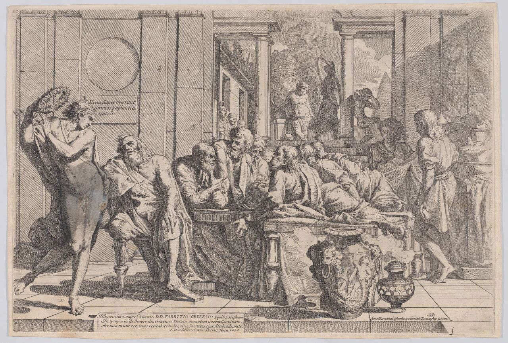

+++
date = '2026-10-27T20:38:00+08:00'
draft = false
title = 'longer-reading-and-writing'
isCJKLanguage = true
math = true
+++

#  Motivations

AI can give us a bunch of words, sentenses and paragraphs, but some steps are still unavoidable for meaningful production -- to decide what core ideas we are taking beyond those isolated bullet points, where to collect grounded evidence to support them and hence to make responsible decisions based on them.

I bought a moderate usage plan which might not be enough for my projects. But I've found that I rarely  continuously hit the 5-hour usage limit and I only feel pressured by it when report deadlines are approaching -- After a few attempts, I came to realize that I should work through my own reasoning before giving any prompts to the agent. Only then can I make real progress, instead of just letting AI generate piles of unread, useless documents. The real bottleneck is that I'm not taking on enough of the workload myself. -- If we have no idea what we're doing and where we're heading, how could we expect an optimizing model to find the exact destination for us? Not to mention AI hallucination and sycophancy still remain to be considered.

It's easy to say that we should stay alert before using and trusting AI-generated results. But it's unexpectedly harder to follow through on it. Because to spot problems when using the results in a familiar field is easy. But what if we don't even have any idea how to evaluate the outputs in the first place? It is totally absurd to expect us to detect the subtle deviations away from our actual goals in the seemingly reasonable outputs.

 We know that we don't know. We know that we know. We don't know that we know, and we don't know that we don't know... How to clarify where an idea should be placed? How to decide the boundaries where we should stop exploring and the promising directions which are worth further pursuing?

These challenges are why I'm starting this column. I want to manually read more and write more, which is the most effective approach to protect our work and our mind from being subtly undermined by AI without any awareness.

# 10/27/2026

## On the Death of Amazon’s Writing Culture

> There is no way to write a six-page, narratively structured memo and not have clear thinking.

什么是亚马逊的写作文化？在senior team开会的时候，汇报者不被允许用ppt或者bulletpoint来呈现自己的汇报内容，因为Bezos认为虽然ppt对于制作者而言是更容易组织的（why？因为华丽的包装和数据、图表比起靠谱的文字更加容易产出和说服audience？），但是对于recipients来说，比起听取一场ppt演讲，一份well-written document能让它们更容易抓住重要的ideas和信息（因为过滤掉了浮华的装饰只剩下最核心的idea？）。因此，在一场1小时会议中，演讲者会带上打印稿分发给大家，前半个小时所有人阅读这份memo，在打印稿上作标注；后半个小时等到大家都掌握了足够的信息后，会议才针对议题展开讨论。

> A senior engineer in my community told me that he has started tagging documents as “AI;DR.” AI; didn’t read. In his view, “If a model wrote it, a model can summarize it.” He had better things to do with his time.
>

idea是他虽然用AI来总结，“如果AI可以写出这些 '6-pagers'，那么它也可以阅读和总结它们。”但是他还是会给AI总结的文档打上 "AI;Didn't Read" 的字眼。所以说在脑子里对于文件有着清晰的管理原则是很重要，有tag这一流程后，文件的可靠性是可以进一步追溯的——究竟哪些是经过认真阅读和确认的资料，哪些是需要再次确认的内容？

> But the deeper cost is the trust between colleagues. A document used to be proof of thought. If you handed me six pages, I knew that you had spent significant time with the problem. Therefore, I knew that it would be worthwhile spending my time to understand your thoughts.

然而开弓没有回头箭，问题并不在于我们如何回到过去，而是在于最本质的真问题——在这样的工作生态已经形成了的前提下，怎样真正地让批判性思考回到工作中来：

> These aren’t arguments for going back to a pre-AI era. That ship has sailed. AI is fundamentally changing the workplace, and for better or worse, you cannot simply prohibit its use. No company is going to ban it completely.

> The real question is how we can do it in a way that doesn’t abdicate critical thinking for critical decisions.

那么该怎么做呢？关于单向门和双向门。

一个决策能否被轻易地回滚，它的犯错成本是不是轻微的，这将决定一件事情能否高度自动化，如果这个决策的成本是轻微的，而且可以被end-to-end地发现和纠正，回滚到正确的方向，那么这个事情就属于一个“双向门”，two-way doors。

补充，关于单向门和双向门的理解：Choosing a crib is a two-way door decision. Having a child is a one-way door. You can return the crib. You cannot return the kid.

更深层次上的理解是，每一个自动化的决策背后都有过深思熟虑的设计。

> Bezos explained the rationale for this way of working in his 2016 annual shareholder letter. He drew a line between one-way doors, the decisions you can’t walk back easily, and two-way doors, the ones you can.
> 
> One-way doors deserve slow, deliberate, clear thought.
> 
> Two-way door decisions should be made fast, because for them, the cost of being wrong is small.
> 
> Most day-to-day engineering decisions are two-way doors. The teams above did what engineering needed to be done to earn the right to not have to write anything.
> 
> Therefore, I propose the following simple rule: Use AI liberally wherever you have engineered a two-way door. Let it write the code, bypass the code review, and ship it. You are allowed to trust the rollback you’ve built.
> 
> But keep the full ritual of a human writing and a human reading for every decision that is a one-way door. If you don’t know whether the decision in front of you is easily reversible or not, then think about it.

其中一个应对AI冲击的方案：

> Rather than banning the use of AI for the creation of documents, she wrote a policy for the engineering team to follow to ensure they communicated well and respected the people who read their documents. The rest of the company adopted it, and when a co-founder posted the policy on LinkedIn it went viral, which tells you how many companies have this problem.

> Here are the salient points:

> You must stand behind every sentence. “Oh, AI wrote that, ignore it” is never an acceptable answer to a reviewer’s question.

> Writing is thinking. A spec or a retrospective is proof that someone has thought about the problem. If you skip the writing then you lose that proof.

> Spend more time writing a document than your readers will spend reading it. One author; many readers. The time you take to ensure you will be understood will have a multiplying benefit..

> Longer is not better. If you have generated a long document from a short prompt, share the prompt instead.

> Quoting generated text is fine as long as you label it as such.

For Amazon, 作者认为可以执行的policy：

> If I were to write it, the policy would have at least three rules:

> Two-way doors can be AI. One-way doors require humans. If an issue can sort itself out or the stakes are low, let the machine do the writing, or don’t write anything at all. Otherwise, a human writes it, and a human reads it and gives feedback.

> You own every word. Generated or typed, if it is in your document, you are accountable for it. If you present a document where it’s clear that the AI did the thinking, the people in that room should feel free to tell your manager, and your manager will treat it as seriously as they treat any other failure to do the job. There must be consequences.

> Certain documents must always be human-written. Some documents only have value if a human has written them. The annual shareholder letters, planning documents (OP1 and OP2), PR-FAQs, any proposal for a new initiative, major rearchitectures, performance reviews, and promotion documents all belong on that list.

结尾，一个很有意思的视角：

# 10/28/2026

## 马元龙︱关于爱：拉康读《会饮》 

> **摘 要**
> 柏拉图的《会饮》作为西方哲学史上至关重要的一个文本，一向被视为以理式为核心的政治哲学的基本文献。但无可否认的是，《会饮》的主题是爱。拉康从独特的精神分析学出发，对这个典型的形而上学文本做了出人意料的解读。他指出，爱的发生的确源于欠缺，但无论爱慕者还是被爱者，都不知道这一欠缺究竟是什么。爱的意义就在于，当我作为一个爱之主体向爱之客体表达时，我所希望的是爱之客体反转成为爱之主体将我当作爱之客体。常识认为，爱就是给出你的所有，但拉康将这个命题反转为“爱就是给出你所没有的东西”。而且，爱也并非只是两个人之间的事情，它要有三方参与，没有第三方，爱就不可能发生。

作为欧洲哲学史上的一个经典文本，柏拉图的《会饮》历来受到众多哲学家的密切关注。法国古代哲学史家罗邦（Léon Robin）的《柏拉图的爱情理论》（La théorie platonicienne de l’amour，1908）可能是最早聚焦于柏拉图爱欲理论的专著；1939年，德国学者克鲁格（Gerhard Krüger）出版了他研究《会饮》的专著《洞见与激情：柏拉图思想的本质》（Einsicht und Leidenschaft: das Wesen des platonischen Denkens）；1957年，施特劳斯（Leo Strauss）在其芝加哥大学的研讨班中，就《会饮》做了系列讲授，这些讲授的文稿后来由其弟子伯纳德特（Seth Benardete）以“施特劳斯论柏拉图的《会饮》”（Leo Strauss on Plato’s Symposium，2001）为名辑录出版。刘小枫认为，克鲁格的著作将《会饮》“提高到理解柏拉图图式哲学的关键位置”，而施特劳斯的讲座则将这个文本“提高到理解柏拉图图式政治哲学乃至政治哲学本身的关键位置”[1]。在上述三部专著以外，《会饮》的研究史或者解释史上还有一个非常重要的文本，那就是拉康在1960—1961年所做的第八期研讨班报告，这一报告后来由米勒（Jacques⁃Alain Miller）以“转移”（Le transfert，1991）为名编辑出版。拉康的《转移》既是关于《会饮》的精神分析学研究，也是关于它的哲学研究。最重要的是，拉康从来无意于成为一个柏拉图研究专家，他的目的始终在于借《会饮》阐述自己关于爱的精神分析学理论。关于爱，我们能从拉康解读的《会饮》中获得什么新的认识呢？

在《会饮》研究中，有两个不容忽视的疑问，其一是其真实性，其二是其文体。柏拉图的《会饮》究竟是对一场真实发生过的精妙绝伦的“会饮”的忠实记录，抑或只是基于他人模糊记忆所作的艺术虚构？借助于文本内外的信息可知，这场文人雅集确有其事：前416年1月，阿伽松在每年一度的莱纳伊亚节赢得悲剧大奖（具体是哪部作品已不得而知），庆典之后的第二天，他邀请几个好友到家中进行一次小范围的宴饮。参加者有哲人苏格拉底、智术师斐德若、享乐主义者鲍沙尼亚、医生厄吕克希马库斯、喜剧诗人阿里斯托芬、苏格拉底的超级“粉丝”阿里斯托德莫斯以及不请自来的青年政治家阿尔基比亚德斯。然而，《会饮》之中每个人的话语都是由阿波罗多洛斯转述的，而他又是从阿里斯托德莫斯那里听来的，因此是转述之转述。柏拉图写作《会饮》时距离“会饮”已经大约四十年[2]，揆诸常情，即使这场“会饮”真的发生过，那些对话也不大可能是真实的记录。就此而言，它们无疑出于柏拉图的虚构，学术界也基本持此观点。然而，拉康并不这么认为，在他看来，古人在经验事物时，总是着眼于将听到的一切牢牢保存在自己的记忆中，这是因为在纸张稀缺、图书很难制作和流通的时代，拥有良好的记忆力非常重要[3]。故而拉康认为，《会饮》中的谈话是真实话语的记录。

关于《会饮》的文体，因为柏拉图的哲学家身份，在很长一段时间内，它一直被当作一篇哲学论文来解读，人们不仅希望从中读出柏拉图关于爱的知识，还想要读出他的政治哲学。但是，任何人都很难忽略《会饮》与亚里士多德那些更为“标准”的论文之间的差别，进入20世纪后，学界越来越明确地意识到，《会饮》固然要表达某种哲学思想，但我们必须将其当作一部戏剧来解读。《会饮》之中的话语的真实性并不妨碍它成为一部戏剧，因为文本的性质取决于文本的风格，与它出于真实还是虚构无关。正因为被当作一部众声喧哗的多声部戏剧而非单声道的论文，《会饮》的多义性和含混性得到了越来越多的关注。虽然早在拉康之前，罗邦就已经集中研究了柏拉图的爱情理论，但他思考的还只是一般意义上的爱情，并仍然将其限定在哲学的范围之内。而当拉康开始阅读这个文本或这出戏时，他关注的既不是一般意义上的爱情理论，也不是一般意义上的柏拉图哲学，而是其中蕴藏的巨大的精神分析潜能。不管《会饮》是柏拉图虚构的一出戏，还是他基于一次文人雅集所创作的一出戏，都丝毫不影响我们对其进行精神分析研究。文学从来就是精神分析的用武之地，何况这出戏是一场关于爱的话语。精神分析不就是一种关于爱的话语吗？

### 一、爱是一个隐喻

《会饮》的主题是爱（Eros）[4]，而且是古希腊式的爱，即拥有美德与智慧的成年男人与尚未长出髭须的少年男子之间的爱。但如果不考虑特殊的历史语境和性别偏见，《会饮》中关于爱的讨论同样适用于一般意义上的爱欲。因此，当拉康在名曰“转移”的研讨班中借题发挥阐述爱的精神分析学理论时，他并未将讨论限定在同性之爱内，而是讨论一般意义上的爱欲。

《会饮》中首先出场赞颂爱神的是斐德若，因为这次会饮的主题正是他建议的。斐德若一开始就以一种不容置疑的语气断言：“在人类与诸神之中，爱神是一个伟大而令人惊奇的神，不仅在其诞生上是这样，在很多方面都是这样。”（178B）[5]爱神的“伟大和令人惊奇”之处不在于他在诸神之中法力最大，而在于他能使人变得无比勇敢：“一旦爱神进入一个人，没有人会卑劣到不走向美德，他甚至仿佛天生就是一个最具有美德的人。”（179A-B）这种美德就是奋不顾身的勇气。没有人愿意为他人去死，但爱神能让人甘愿为自己所爱的人献出生命。为了证明这一点，斐德若援引了三个例证：塞萨利的国王阿德墨托斯死期将至，没有人愿意替他去死，即使是其行将就木的父母，为了救他，妻子阿尔刻提斯毅然请死以代；阿波罗的儿子俄耳甫斯为让妻子欧律狄克死而复生，冲破重重阻碍下到冥府求告冥王哈德斯；阿喀琉斯明知若要替帕特罗克洛斯报仇，自己也必将死于战场，但仍然执意为之并最终殒命。斐德若认为，在这三个感人至深的爱的故事中，俄耳甫斯对欧律狄克的爱分量最轻，“他太软弱，真的就是一个竖琴师，不敢像阿尔刻提斯那样为爱而死，只想活着进入冥府”（179D）。至于阿尔刻提斯和阿喀琉斯，虽然二者都勇于为爱献身，都受到诸神的赞扬和恩宠（阿尔刻提斯死而复生，阿喀琉斯死后去了福乐岛），但诸神更赞赏阿喀琉斯，原因何在呢？

> “一旦爱神进入一个人，没有人会卑劣到不走向美德，他甚至仿佛天生就是一个最具有美德的人。”

## [2016 letter to shareholders](https://www.aboutamazon.com/news/company-news/2016-letter-to-shareholders)

> 不要用一种解决不了问题的机制，反复处理同一个问题。

遇到一场持续很久的争论，可以问四个问题：

1. 我们是否追求同一个最终目标？
- 是，目标相同
- 目标或优先级存在冲突
- 还不清楚

2. 分歧主要来自哪里？
- 证据或预测不同
- 实现路径不同
- 目标、原则或权衡规则不同

3. 继续讨论是否有望产生新信息或新方案？
- 有，仍有重要问题待验证
- 没有，只是在重复原有立场
- 不确定

4. 当前团队是否有明确的决策人和裁决规则？
- 有
- 没有，权限或规则不清楚

https://www.aboutamazon.com/news/company-news/amazons-original-1997-letter-to-shareholders

# 10/29/2026

## How to systematically note better in AI era?

## Two kinds of notes

## PART A -- Notes structurized in a cheatsheet standard.

Demand:
Complete: Like a personal dictionary, arrange concepts and narrations in a comfortable order.

For example, when I was first introduced to the concept of stable matching, the lecturer gave us a usual example, how do admission systems of university work? To think about this issue.

...

Concise: Shorter than the lecture note, save time for the future me to quickly get back to the situation -- What problem does this chapter focus on? What concept does it introduce and what's the motivation?

The main goal is to help us quickly get the main point
