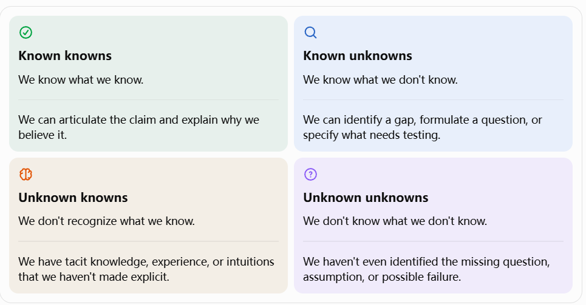
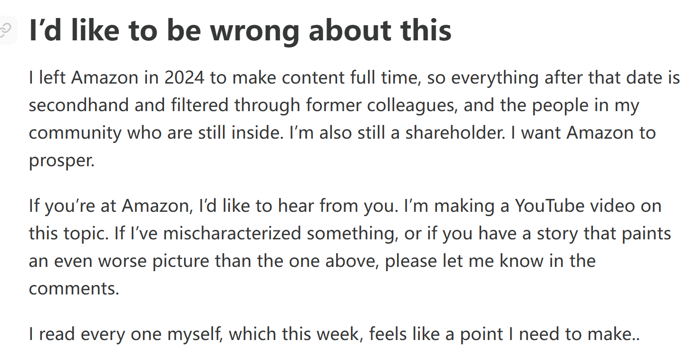

+++
date = '2026-10-27T20:38:00+08:00'
draft = false
title = 'longer-reading-and-writing'
isCJKLanguage = true
math = true
+++

#  Motivations

AI can give us a bunch of words, sentenses and paragraphs, but some steps are still unavoidable for meaningful production -- to decide what core ideas we are taking beyond those isolated bullet points, where to collect grounded evidence to support them and hence to make responsible decisions based on them.

I bought a moderate usage plan which might not be enough for my projects. But I've found that I rarely  continuously hit the 5-hour usage limit and I only feel pressured by it when report deadlines are approaching -- After a few attempts, I came to realize that I should work through my own reasoning before giving any prompts to the agent. Only then can I make real progress, instead of just letting AI generate piles of unread, useless documents. The real bottleneck is that I'm not taking on enough of the workload myself. -- If we have no idea what we're doing and where we're heading, how could we expect an optimizing model to find the exact destination for us? Not to mention AI hallucination and sycophancy still remain to be considered.

It's easy to say that we should stay alert before using and trusting AI-generated results. But it's unexpectedly harder to follow through on it. Because to spot problems when using the results in a familiar field is easy. But what if we don't even have any idea how to evaluate the outputs in the first place? It is totally absurd to expect us to detect the subtle deviations away from our actual goals in the seemingly reasonable outputs.

 We know that we don't know. We know that we know. We don't know that we know, and we don't know that we don't know... How to clarify where an idea should be placed? How to decide the boundaries where we should stop exploring and the promising directions which are worth further pursuing?

These challenges are why I'm starting this column. I want to manually read more and write more, which is the most effective approach to protect our work and our mind from being subtly undermined by AI without any awareness.

# 10/27/2026

## On the Death of Amazon’s Writing Culture

> There is no way to write a six-page, narratively structured memo and not have clear thinking.

什么是亚马逊的写作文化？在senior team开会的时候，汇报者不被允许用ppt或者bulletpoint来呈现自己的汇报内容，因为Bezos认为虽然ppt对于制作者而言是更容易组织的（why？因为华丽的包装和数据、图表比起靠谱的文字更加容易产出和说服audience？），但是对于recipients来说，比起听取一场ppt演讲，一份well-written document能让它们更容易抓住重要的ideas和信息（因为过滤掉了浮华的装饰只剩下最核心的idea？）。因此，在一场1小时会议中，演讲者会带上打印稿分发给大家，前半个小时所有人阅读这份memo，在打印稿上作标注；后半个小时等到大家都掌握了足够的信息后，会议才针对议题展开讨论。

> A senior engineer in my community told me that he has started tagging documents as “AI;DR.” AI; didn’t read. In his view, “If a model wrote it, a model can summarize it.” He had better things to do with his time.
>

idea是他虽然用AI来总结，“如果AI可以写出这些 '6-pagers'，那么它也可以阅读和总结它们。”但是他还是会给AI总结的文档打上 "AI;Didn't Read" 的字眼。所以说在脑子里对于文件有着清晰的管理原则是很重要，有tag这一流程后，文件的可靠性是可以进一步追溯的——究竟哪些是经过认真阅读和确认的资料，哪些是需要再次确认的内容？

> But the deeper cost is the trust between colleagues. A document used to be proof of thought. If you handed me six pages, I knew that you had spent significant time with the problem. Therefore, I knew that it would be worthwhile spending my time to understand your thoughts.

然而开弓没有回头箭，问题并不在于我们如何回到过去，而是在于最本质的真问题——在这样的工作生态已经形成了的前提下，怎样真正地让批判性思考回到工作中来：

> These aren’t arguments for going back to a pre-AI era. That ship has sailed. AI is fundamentally changing the workplace, and for better or worse, you cannot simply prohibit its use. No company is going to ban it completely.

> The real question is how we can do it in a way that doesn’t abdicate critical thinking for critical decisions.

那么该怎么做呢？关于单向门和双向门。

一个决策能否被轻易地回滚，它的犯错成本是不是轻微的，这将决定一件事情能否高度自动化，如果这个决策的成本是轻微的，而且可以被end-to-end地发现和纠正，回滚到正确的方向，那么这个事情就属于一个“双向门”，two-way doors。

更深层次上的理解是，每一个自动化的决策背后都有过深思熟虑的设计。

> Bezos explained the rationale for this way of working in his 2016 annual shareholder letter. He drew a line between one-way doors, the decisions you can’t walk back easily, and two-way doors, the ones you can.
> 
> One-way doors deserve slow, deliberate, clear thought.
> 
> Two-way door decisions should be made fast, because for them, the cost of being wrong is small.
> 
> Most day-to-day engineering decisions are two-way doors. The teams above did what engineering needed to be done to earn the right to not have to write anything.
> 
> Therefore, I propose the following simple rule: Use AI liberally wherever you have engineered a two-way door. Let it write the code, bypass the code review, and ship it. You are allowed to trust the rollback you’ve built.
> 
> But keep the full ritual of a human writing and a human reading for every decision that is a one-way door. If you don’t know whether the decision in front of you is easily reversible or not, then think about it.

其中一个应对AI冲击的方案：

> Rather than banning the use of AI for the creation of documents, she wrote a policy for the engineering team to follow to ensure they communicated well and respected the people who read their documents. The rest of the company adopted it, and when a co-founder posted the policy on LinkedIn it went viral, which tells you how many companies have this problem.

> Here are the salient points:

> You must stand behind every sentence. “Oh, AI wrote that, ignore it” is never an acceptable answer to a reviewer’s question.

> Writing is thinking. A spec or a retrospective is proof that someone has thought about the problem. If you skip the writing then you lose that proof.

> Spend more time writing a document than your readers will spend reading it. One author; many readers. The time you take to ensure you will be understood will have a multiplying benefit..

> Longer is not better. If you have generated a long document from a short prompt, share the prompt instead.

> Quoting generated text is fine as long as you label it as such.

For Amazon, 作者认为可以执行的policy：

> If I were to write it, the policy would have at least three rules:

> Two-way doors can be AI. One-way doors require humans. If an issue can sort itself out or the stakes are low, let the machine do the writing, or don’t write anything at all. Otherwise, a human writes it, and a human reads it and gives feedback.

> You own every word. Generated or typed, if it is in your document, you are accountable for it. If you present a document where it’s clear that the AI did the thinking, the people in that room should feel free to tell your manager, and your manager will treat it as seriously as they treat any other failure to do the job. There must be consequences.

> Certain documents must always be human-written. Some documents only have value if a human has written them. The annual shareholder letters, planning documents (OP1 and OP2), PR-FAQs, any proposal for a new initiative, major rearchitectures, performance reviews, and promotion documents all belong on that list.

结尾，一个很有意思的视角：

